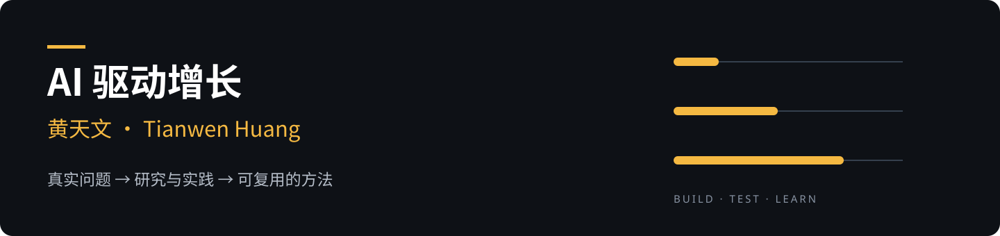

我是黄天文，**[WhoBot 呼波特](https://www.whobot.com/about) COO、《引爆用户增长》作者**。

我关心一个问题：**AI 化之后，生意本身有没有变得更好？**

这里记录我对 AI 与增长的研究、实践和工具。把真实问题拆开，把判断放进实验，再把能复用的东西留下来。

[使用天文增长诊断 Skill](https://github.com/huangtianwen1986/tianwen-growth-skill) · [进入 AI 增长实践库](https://github.com/huangtianwen1986/ai-growth-notes) · [体验 WhoBot](https://www.whobot.com/?utm_source=github&utm_medium=profile&utm_campaign=tianwen_ip&utm_content=hero) · [WhoBot 电话 Skill](https://github.com/whobot-com/openclaw-whobot-skill)

### 从这里开始

| 你正在解决的问题 | 可以拿走的东西 |
| --- | --- |
| 增长卡住了，不确定先改哪一环 | [天文增长诊断 Skill](https://github.com/huangtianwen1986/tianwen-growth-skill)：核对指标、识别瓶颈、设计实验 |
| 想上 AI，但不知道先做哪一步 | [AI 项目决策卡](https://github.com/huangtianwen1986/ai-growth-notes/blob/main/templates/ai-project-decision.md)：目标、瓶颈、成本、试验与停止条件 |
| 电话 Agent 能聊了，怎么判断能不能上岗 | [电话数字员工验收卡](https://github.com/huangtianwen1986/ai-growth-notes/blob/main/templates/voice-agent-acceptance.md)：把对话、任务执行和结果分开验证 |
| 做过一次 AI 实践，想把经验留下来 | [实践记录模板](https://github.com/huangtianwen1986/ai-growth-notes/blob/main/templates/experiment-log.md)：原始问题、证据、结果与修正 |

### 我持续研究的方向

- **AI 与业务增长**：效率提升之后，瓶颈去了哪里，业务结果有没有改变。
- **数字员工进入流程**：从完成一个任务，到接进岗位、系统和交付。
- **个人的 AI 工作方式**：把真实做过的事整理成可复用的方法和工具。

### 公开方法与实践

《引爆用户增长》的方法正在整理成可使用、可修正的增长工具。第一版依据新书分享讲义，原有方法与新增实验模板分别标注。

- [天文增长诊断与方法来源](https://github.com/huangtianwen1986/tianwen-growth-skill/blob/main/docs/source-map.md)
- [互联网增长、外卖试验与招商数字化的公开资料](https://github.com/huangtianwen1986/tianwen-growth-skill/blob/main/docs/public-profile.md)

### 我和 WhoBot

我在 WhoBot 负责运营与增长。WhoBot 做面向企业电话业务的 AI 电话数字员工。

想看产品能力，去 [WhoBot 官网](https://www.whobot.com/?utm_source=github&utm_medium=profile&utm_campaign=tianwen_ip&utm_content=whobot)；想在 AI 助手里使用，去 [官方 Skill 仓库](https://github.com/whobot-com/openclaw-whobot-skill) 和 [使用文档](https://www.whobot.com/skills/docs/)。

这里的工作表和实践记录是个人整理，产品功能、价格与使用要求以官方文档为准。

### 最近更新

- **2026-11-06**：[天文增长诊断 v0.1.0](https://github.com/huangtianwen1986/tianwen-growth-skill)公开试用版上线，提供诊断流程、实验卡与演示案例。
- **2026-11-06**：[AI 增长实践库起步版](https://github.com/huangtianwen1986/ai-growth-notes)上线，开放两张工作表和一份实践记录模板。

### 找到我

GitHub 关注本账号，查看后续作品；公众号搜索 **「大虫运营心经」**。

有可公开的业务问题、试用反馈或反例，欢迎到 [实践库 Issues](https://github.com/huangtianwen1986/ai-growth-notes/issues) 交流。

Tianwen Huang · COO at WhoBot · Author of《引爆用户增长》. Exploring how AI changes business outcomes through practical experiments.
